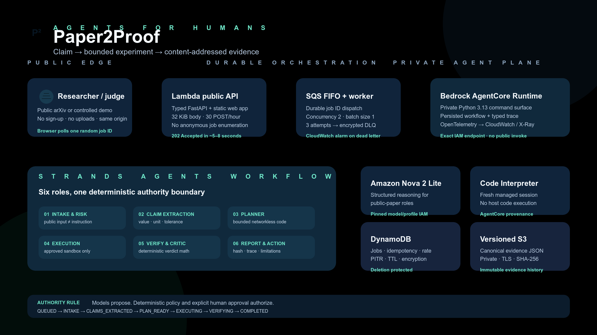

# Paper2Proof

> From computational papers to reproducible evidence, without the busywork.

[Launch the live AWS demo](https://ptvrh62d34oqwkz4x6cjtbvxgm0yaimi.lambda-url.us-west-2.on.aws/) · [Watch the 4:21 demo](https://youtu.be/4YJcxveYEyk) · [Architecture](docs/architecture.md) · [Evaluation](docs/evaluation.md) · [Security](docs/security.md)

Builder notes: [claim to evidence](https://builder.aws.com/content/3IhG4Wzvjq3mT4Z3PybT1TzjYxE/agents-for-humans-turning-a-paper-claim-into-evidence-with-paper2proof) · [durable AgentCore workflow](https://builder.aws.com/content/3IhGUvAhZ6b0S8haL5BEyAMppP0/agents-for-humans-a-durable-agentcore-workflow) · [responsible-agent evaluation](https://builder.aws.com/content/3IhGko62tQxPGWDVRSHqefe5tPc/agents-for-humans-when-stopping-is-agent-success)

Paper2Proof is an autonomous research reproducibility steward for independent
computational researchers and small teams. Give it one public paper or a
controlled demo. Six specialized Strands agents identify a bounded numerical
claim, propose a reproducible experiment, pause at scientific or safety
boundaries, run approved code in Amazon Bedrock AgentCore Code Interpreter,
and return content-addressed evidence.



## Try it in 60 seconds

1. Open the [live demo](https://ptvrh62d34oqwkz4x6cjtbvxgm0yaimi.lambda-url.us-west-2.on.aws/).
2. Select **Reproducible mean** and press **Run evidence workflow**.
3. Watch the durable `QUEUED` job progress through the agent and tool trace.
4. Inspect the deterministic verdict, AgentCore session provenance, and
   SHA-256 evidence identifier; download JSON or Markdown.
5. Try **Ambiguous spread** to see a human decision gate, or enter a public
   arXiv URL to have Amazon Nova extract and plan a real claim.

The public paper path intentionally stops before execution when license or
scientific interpretation requires review. A successful run is evidence about
one claim under stated conditions—not proof that a whole paper is true.

## What is agentic about it?

Paper2Proof is not a chat wrapper. A persisted workflow continues server-side
after the browser receives `202 Accepted`:

`QUEUED → INTAKE → CLAIMS_EXTRACTED → PLAN_READY → EXECUTING → VERIFYING → COMPLETED`

It branches to `AWAITING_APPROVAL`, `BLOCKED`, `PARTIAL`, or `FAILED` with a
structured reason. Strands agents perform intake, claim extraction, planning,
critique, and reporting. Deterministic code—not the model—owns URL policy,
code safety, budgets, state transitions, and numerical verdicts.

The six roles are:

1. **Intake & Risk** — normalizes public sources and treats their contents as
   untrusted data.
2. **Claim Extraction** — connects a numerical claim to a source locator,
   conditions, unit, and tolerance.
3. **Reproduction Planner** — creates one CPU-sized, networkless experiment.
4. **Execution** — invokes AgentCore Code Interpreter only after policy and
   approval gates pass.
5. **Verification & Critic** — checks limitations while deterministic math
   compares observed and reported values.
6. **Report & Action** — packages hashes, timestamps, transitions, trace,
   provenance, and the next human decision.

## Verified results

The versioned local contract evaluation in [`evals/results.json`](evals/results.json)
runs 12 fresh, networkless Docker cases:

| Measure | Result |
|---|---:|
| Expected outcomes | **12 / 12** |
| Unsafe/dependency plans blocked before execution | **100% (3 / 3)** |
| Prompt-injection fixture detected and ignored | **100% (1 / 1)** |
| Correct human escalation | **100% (1 / 1)** |
| Evidence/schema completeness | **100%** |
| Unapproved external writes | **0** |
| Median / p95 local latency | **384 ms / 442 ms** |

The local evaluation is deliberately labeled `docker-local`; it does not
pretend to be an AWS run. Separately verified production evidence includes:

- controlled PASS: `job_c18560e7fe264129a99c60199571bad0`, completed in
  21 seconds through AgentCore Code Interpreter;
- unsafe import: `job_abbc697556cb4b91b0fa4cfe216f2825`, deterministically
  blocked before execution;
- human gate: `job_0c6cc4bd2d294282a99ed7461809428d`, paused and then rejected
  without execution;
- real paper: `job_acbce73ded684e228165adf8358740c3`, where Strands + Amazon
  Nova extracted a claim from *Attention Is All You Need* and stopped for
  license/interpretation approval.

See [Evaluation](docs/evaluation.md) for exact scope and limitations.

## AWS implementation

- **Amazon Bedrock AgentCore Runtime** hosts the private Python 3.13 agent
  service with OpenTelemetry enabled.
- **Amazon Nova 2 Lite** supplies structured reasoning for public papers.
- **AgentCore Code Interpreter** is the only production code-execution tool.
- **Amazon SQS FIFO + Lambda worker** makes browser requests durable and
  retry-bounded; a DLQ alarm detects exhausted retries.
- **DynamoDB** persists idempotent jobs and rate-limit counters with point-in-
  time recovery, deletion protection, encryption, and TTL.
- **S3** stores versioned, private, SHA-256-addressed evidence.
- **Lambda Function URL** serves the same-origin UI and typed API; CloudWatch
  alarms and logs cover the public boundary and worker.

The public API cannot list other users' jobs. A job can only be fetched through
its 128-bit random identifier. POST requests are limited to 32 KiB and 30 per
hashed source IP per hour. See [Architecture](docs/architecture.md) and
[Security](docs/security.md).

## Local development

Prerequisites: Python 3.13, [`uv`](https://docs.astral.sh/uv/), and Docker.
Node.js 20+ is required only for AgentCore CDK infrastructure.

```bash
uv sync --frozen --all-groups
uv run ruff check services/agent/src tests
uv run ruff format --check services/agent/src tests
uv run mypy services/agent/src
uv run pytest -q --cov=paper2proof --cov-report=term
uv run paper2proof run-fixture reproducible-mean
```

Run the full versioned evaluation:

```bash
uv run python scripts/run-evaluation.py
```

Run the web app locally with deterministic fixtures:

```bash
PAPER2PROOF_RUNTIME_MODE=fixture uv run uvicorn paper2proof.api:app --reload
```

Open `http://127.0.0.1:8000`. The exact settings contract is documented in
[`.env.example`](.env.example). Docker execution uses a digest-pinned image,
no network, read-only root, dropped capabilities, resource limits, and tmpfs.

## Reproducing the deployment

The repository contains the complete infrastructure and deterministic Lambda
packaging inputs:

- [`infra/aws/foundation.yaml`](infra/aws/foundation.yaml) — DynamoDB, S3, and budget;
- [`agentcore/agentcore.json`](agentcore/agentcore.json) — Runtime definition;
- [`agentcore/policies/runtime-policy.json`](agentcore/policies/runtime-policy.json) —
  exact application permissions;
- [`infra/aws/application.yaml`](infra/aws/application.yaml) — public API,
  queue, worker, alarms, and least-privilege roles;
- [`scripts/package-lambda.sh`](scripts/package-lambda.sh) — reproducible ARM64 package.

AWS account-specific bucket names and ARNs in the checked-in deployment files
describe the hackathon environment; use your own account and resource names
for a separate deployment. No credentials or secret values are committed.

## Repository map

```text
services/agent/src/paper2proof/  workflow, agents, policy, stores, web UI
services/runtime/                AgentCore Runtime entry point
services/api/                    Lambda API and SQS worker adapters
fixtures/                        12 transparent evaluation contracts
evals/                           versioned measured result
infra/aws/                       CloudFormation foundation and public edge
agentcore/                       AgentCore configuration, policy, and CDK
docs/                            architecture, security, evaluation, testing
hackathon/                       evidence log and submission materials
```

## Disclosure and license

Paper2Proof was created from a blank repository on 2026-08-31 during the
Agents for Humans Hackathon submission period. OpenAI Codex was used as a
development assistant. Frameworks, source provenance, truth labels, and
validation boundaries are documented in [Disclosures](docs/disclosures.md).

MIT licensed. See [LICENSE](LICENSE). Contributions follow
[CONTRIBUTING.md](CONTRIBUTING.md) and [CODE_OF_CONDUCT.md](CODE_OF_CONDUCT.md).
